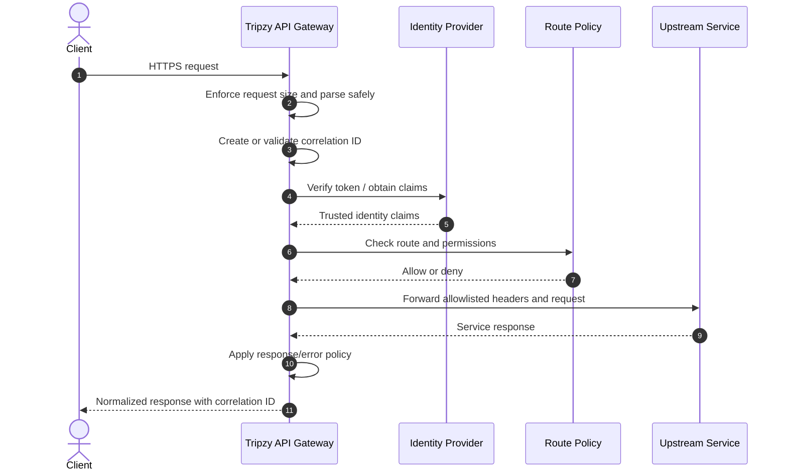
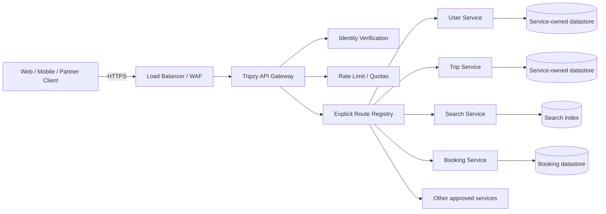

# 🚦 API Gateway Tripzy

<div align="center">

**A Node.js API gateway foundation for the Tripzy microservices ecosystem**

[](https://nodejs.org/)
[](https://developer.mozilla.org/en-US/docs/Web/JavaScript)
[](./LICENSE)
[](https://github.com/Brajesh31/API-Gateway-Tripzy/actions/workflows/ci.yml)

</div>

> **Current implementation status: scaffold only.** This repository currently contains a Node.js package manifest and project documentation. It does not yet contain a gateway server, proxy routes, authentication middleware, upstream service registry, tests, or a deployable runtime. This README deliberately separates intended architecture from shipped behavior.

## 🧭 Contents

- [Purpose](#-purpose)
- [Implementation status](#-implementation-status)
- [What an API gateway should own](#-what-an-api-gateway-should-own)
- [Proposed request lifecycle](#-proposed-request-lifecycle)
- [Architecture boundaries](#-architecture-boundaries)
- [Repository layout](#-repository-layout)
- [Getting started](#-getting-started)
- [Configuration](#-configuration)
- [API contract status](#-api-contract-status)
- [Security baseline](#-security-baseline)
- [Testing strategy](#-testing-strategy)
- [Observability](#-observability)
- [Deployment readiness](#-deployment-readiness)
- [Documentation index](#-documentation-index)
- [Contributing](#-contributing)
- [License](#-license)

## 🎯 Purpose

Tripzy is expected to be composed of independently owned services. A gateway can provide a controlled client-facing entry point and enforce cross-cutting request policies consistently. This repository is the starting point for that boundary.

A gateway is not merely a collection of URL rewrites. Its design must account for identity, authorization, service ownership, timeouts, retries, failure isolation, data exposure, observability, and backward-compatible contracts.

## 📌 Implementation status

| Capability | Repository status | Evidence / next action |
|---|---|---|
| Node.js package metadata | Present | `package.json` |
| Environment example | Present | `.env.example`, placeholders only |
| Gateway server | Not implemented | No entry-point source file |
| HTTP framework | Not selected or installed | Choose after service contracts |
| Proxy/router | Not implemented | Define upstream service registry |
| Authentication | Not implemented | Select identity provider and token contract |
| Authorization | Not implemented | Define per-route policy |
| Rate limiting | Not implemented | Define user/client keys and distributed strategy |
| Request IDs | Not implemented | Define trusted propagation rules |
| Timeout/retry policy | Not implemented | Define idempotency and per-service budgets |
| Health/readiness routes | Not implemented | Define dependency semantics |
| Automated tests | Not implemented | Current package test command is placeholder |
| CI pipeline | Repository automation to be added | See workflow files |
| Deployment | Not supported yet | Runtime and hosting topology are undecided |

Do not advertise the project as a functioning gateway until the server, route map, security middleware, and tests have landed.

## 🧱 What an API gateway should own

The proposed responsibility boundary is intentionally narrow.

| Responsibility | Gateway role | Must remain owned by |
|---|---|---|
| Client-facing routing | Match explicitly registered paths and methods | Gateway configuration |
| Authentication | Verify identity tokens or delegate to a trusted identity provider | Identity provider and security policy |
| Authorization | Enforce route-level permissions before forwarding | Service/product owners define permissions |
| Request validation | Validate public contract and payload limits | Public API contract |
| Rate limiting | Apply client/user limits and return clear 429 responses | Platform policy |
| Traffic resilience | Enforce timeouts and carefully bounded retries | Gateway plus upstream service owners |
| Correlation | Propagate a validated request ID | Observability policy |
| Error handling | Avoid leaking upstream internals | Gateway |
| Domain behavior | Do not duplicate business rules | Owning Tripzy microservice |
| Persistence | Prefer stateless request handling | Owning service/database |

## 🔁 Proposed request lifecycle

The following is a target design, not current runtime behavior.



A request must be rejected before forwarding when authentication, authorization, validation, route registration, or policy checks fail.

## 🏗️ Architecture boundaries



Service names in this diagram are illustrative examples only. This repository does not confirm that these services exist, nor does it configure their URLs. Replace the example labels with verified Tripzy service contracts before implementation.

### Architectural rules

1. The gateway must not connect directly to every service database.
2. Upstream destinations must come from trusted configuration, never arbitrary client input.
3. Authorization must be evaluated before proxying.
4. Forward only required headers. Never blindly forward hop-by-hop headers or untrusted identity headers.
5. A timeout budget must exist for every upstream call.
6. Retries must be restricted to safe/idempotent operations or requests protected by an idempotency contract.
7. Health checks must distinguish gateway process health from upstream dependency health.
8. Error responses must not expose stack traces, internal DNS names, tokens, or raw upstream response bodies.

## 🗂️ Repository layout

```text
API-Gateway-Tripzy/
├── .github/
│   ├── ISSUE_TEMPLATE/
│   ├── workflows/
│   └── PULL_REQUEST_TEMPLATE.md
├── docs/
│   ├── api.md
│   ├── architecture.md
│   ├── configuration.md
│   ├── development.md
│   ├── deployment.md
│   ├── security.md
│   ├── testing.md
│   ├── operations.md
│   ├── threat-model.md
│   ├── service-contracts.md
│   └── diagrams/
├── .editorconfig
├── .env.example
├── .gitattributes
├── .gitignore
├── CHANGELOG.md
├── CITATION.cff
├── CODEOWNERS
├── CODE_OF_CONDUCT.md
├── CONTRIBUTING.md
├── LICENSE
├── package.json
├── README.md
├── ROADMAP.md
├── SECURITY.md
└── SUPPORT.md
```

The source directory will be introduced with the first server implementation. See [Project structure](./docs/project-structure.md).

## 🚀 Getting started

### Prerequisites

- Node.js LTS supported by the deployment environment.
- npm.
- Git.
- Verified Tripzy service contracts before configuring any upstream URL.

### Clone and inspect

```bash
git clone https://github.com/Brajesh31/API-Gateway-Tripzy.git
cd API-Gateway-Tripzy
npm install
```

At this stage there is no `npm start` or `npm run dev` command because no server source file exists. The package's current test command is a placeholder which exits with an error. This is intentional until a real test suite is configured.

Read [Installation](./docs/installation.md) and [Development](./docs/development.md) before adding runtime code.

## ⚙️ Configuration

The checked-in `.env.example` contains only proposed environment names. Environment loading is not implemented yet.

Likely configuration areas include:

| Setting | Purpose | Status |
|---|---|---|
| `PORT` | Gateway listener port | Example only |
| `LOG_LEVEL` | Runtime log verbosity | Example only |
| `UPSTREAM_*_URL` | Trusted upstream service destinations | Not configured |
| `JWT_ISSUER` | Expected token issuer | Not configured |
| `JWT_AUDIENCE` | Expected token audience | Not configured |
| `RATE_LIMIT_*` | Quota policy | Not configured |
| `*_TIMEOUT_MS` | Service-specific request budget | Not configured |

Never commit production credentials or copy private values into `VITE_*`/public frontend configuration. Use a hosting secret manager for secrets.

## 🔌 API contract status

No routes are currently implemented. The future API contract must document method, path, versioning, auth requirement, permission, request schema, response schema, status codes, timeout, retry behavior, and owning service.

See [API contract and conventions](./docs/api.md) and [service contract register](./docs/service-contracts.md).

## 🛡️ Security baseline

The gateway is a high-trust boundary. Before public traffic is enabled, implement:

- Token verification against explicit issuer, audience, algorithm, and key policy.
- Route-level authorization and deny-by-default behavior.
- Strict upstream host allowlists to prevent SSRF.
- Request and response size limits.
- Rate limiting and abuse controls.
- Safe header forwarding and hop-by-hop header removal.
- Timeout budgets and bounded retry policy.
- TLS termination and trusted proxy configuration.
- Structured logs with sensitive fields redacted.
- Dependency scanning and security regression tests.

Read [Security](./SECURITY.md), [Threat model](./docs/threat-model.md), and [Security engineering guide](./docs/security.md).

## 🧪 Testing strategy

The future test suite should include:
- Unit tests for route matching, policy checks, header filtering, and error mapping.
- Contract tests for every registered upstream route.
- Integration tests using mocked upstream servers.
- Negative tests for invalid tokens, missing permissions, malformed requests, unknown destinations, and timeouts.
- Load tests for rate limits and concurrency under controlled conditions.
- Security tests for SSRF, request smuggling assumptions, open proxy behavior, and header spoofing.

No such test suite is present yet. See [Testing strategy](./docs/testing.md).

## 📈 Observability

The target baseline is structured request logs, correlation IDs, request duration, upstream duration, status code, timeout/retry counters, rate-limit rejections, and dependency health. Do not log access tokens, cookies, passwords, authorization headers, or complete private payloads.

See [Observability and operations](./docs/operations.md).

## 🚢 Deployment readiness

<badge color="warning">Not deployable yet</badge>

No runtime server is implemented. A production release requires a working process, secrets injection, route allowlists, identity verification, health/readiness endpoints, monitoring, capacity limits, rollback procedure, and integration tests.

See [Deployment checklist](./docs/deployment.md).

## 📚 Documentation index

| Guide | What it covers |
|---|---|
| [Documentation home](./docs/README.md) | Full guide map and maintenance rules |
| [Project overview](./docs/project-overview.md) | Scope, goals, non-goals, terminology |
| [Architecture](./docs/architecture.md) | Boundaries, components, request lifecycle |
| [Project structure](./docs/project-structure.md) | Planned source layout and file responsibilities |
| [API conventions](./docs/api.md) | Route contract and response/error standards |
| [Service contracts](./docs/service-contracts.md) | Upstream registry and ownership template |
| [Configuration](./docs/configuration.md) | Variables, secrets, validation, environments |
| [Development](./docs/development.md) | Branches, coding practices, local workflow |
| [Installation](./docs/installation.md) | Prerequisites and current scaffold setup |
| [Testing](./docs/testing.md) | Unit, contract, integration, security and load tests |
| [Security](./docs/security.md) | Gateway-specific defensive controls |
| [Threat model](./docs/threat-model.md) | Assets, trust boundaries, abuse cases |
| [Deployment](./docs/deployment.md) | Readiness, rollout, rollback |
| [Operations](./docs/operations.md) | Health, diagnostics, incidents, SLO planning |
| [Database](./docs/database.md) | Stateless gateway and persistence boundaries |
| [Troubleshooting](./docs/troubleshooting.md) | Diagnostics and failure handling |
| [FAQ](./docs/faq.md) | Scope and implementation status |

## 🤝 Contributing

Read [CONTRIBUTING.md](./CONTRIBUTING.md). Changes to route configuration must include contract tests, security review, and documentation updates. Do not add invented upstream endpoints.

## 📄 License

MIT License. See [LICENSE](./LICENSE).

Maintained by **Brajesh Kumar**: [@Brajesh31](https://github.com/Brajesh31).

Last updated: 2026-11-16 07:16 UTC
