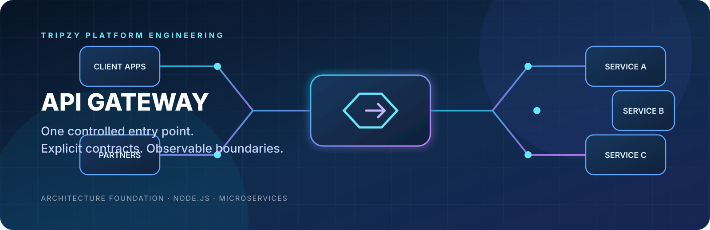
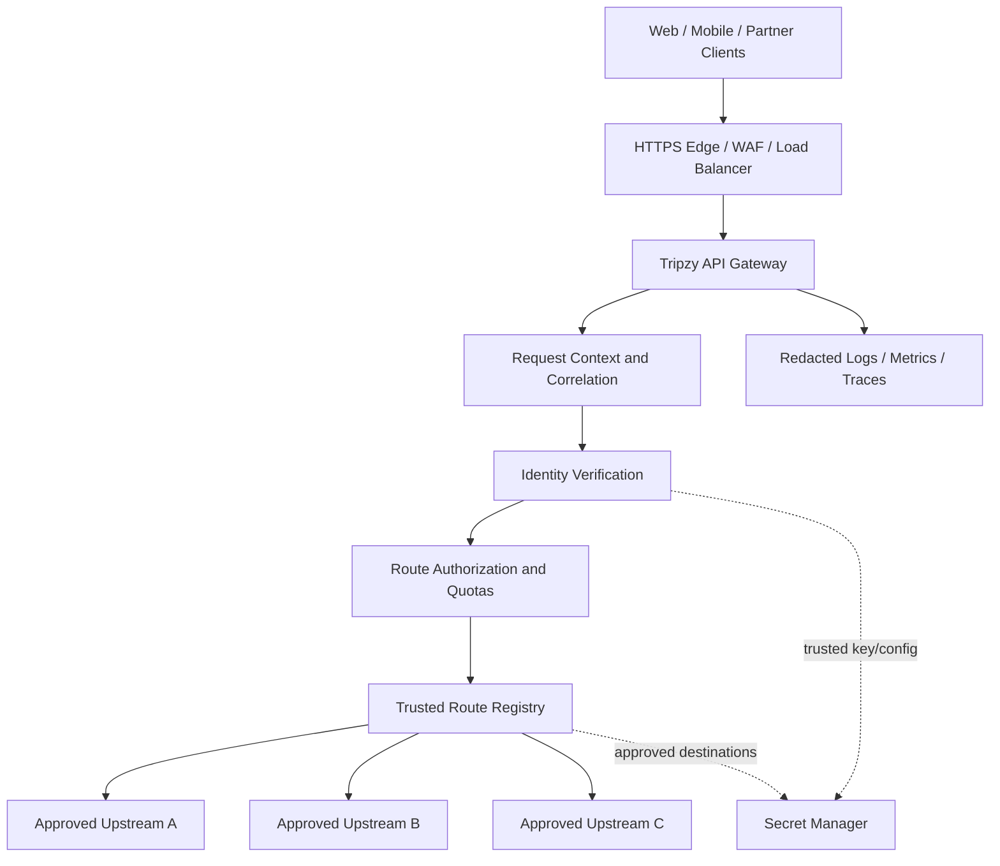
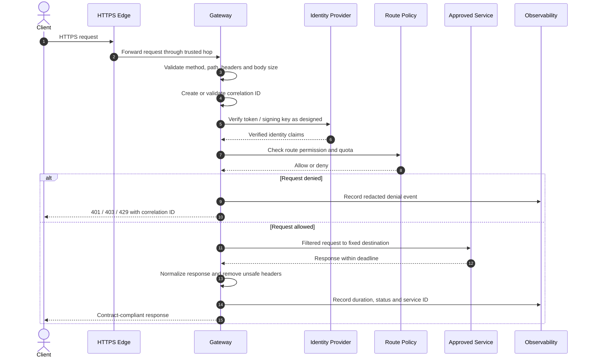
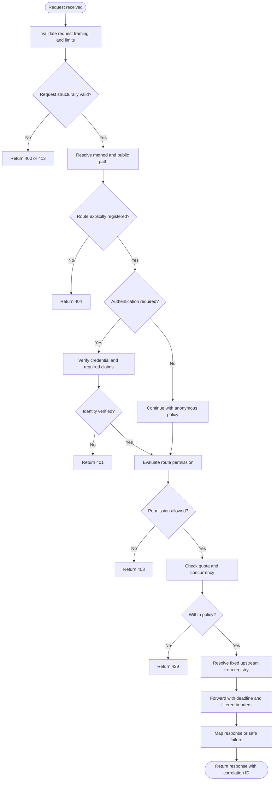
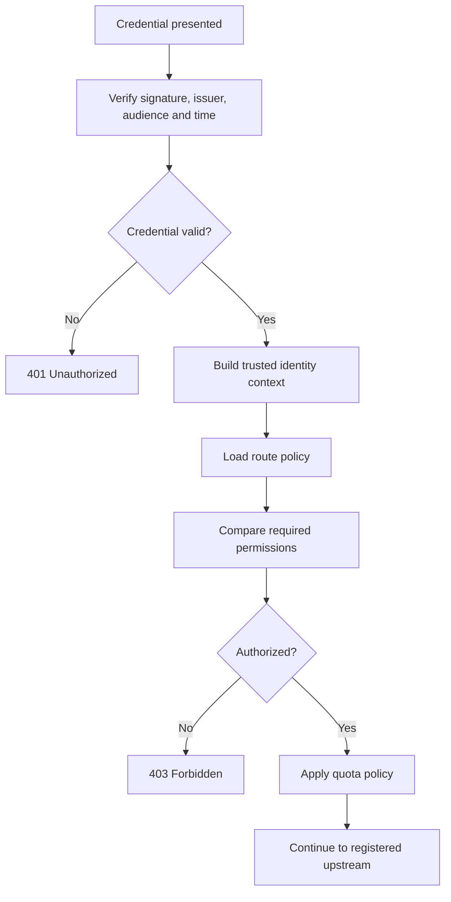
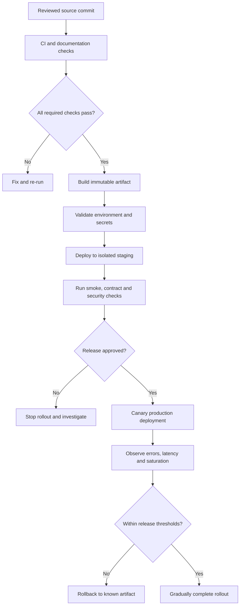

<div align="center">
  
  <h1>🚦 API Gateway Tripzy</h1>
  <p><strong>A documented Node.js API gateway foundation for the Tripzy service ecosystem.</strong></p>
  <p>One controlled entry point. Explicit service contracts. Observable request boundaries.</p>
  <p>
    <a href="https://github.com/Brajesh31/API-Gateway-Tripzy/actions/workflows/ci.yml"></a>
    <a href="https://github.com/Brajesh31/API-Gateway-Tripzy/actions/workflows/security.yml"></a>
    
    
    <a href="LICENSE"></a>
    
    <a href="https://github.com/Brajesh31/API-Gateway-Tripzy/commits/main"></a>
    <a href="https://github.com/Brajesh31/API-Gateway-Tripzy"></a>
  </p>
  <p>
    <a href="#-project-status-read-this-first">Project status</a> ·
    <a href="#-architecture-at-a-glance">Architecture</a> ·
    <a href="docs/README.md">Documentation</a> ·
    <a href="CONTRIBUTING.md">Contributing</a>
  </p>
</div>

---

> [!IMPORTANT]
> **This repository is currently a documentation and project-structure foundation, not a running API gateway.** The inspected default branch contains package metadata and documentation, but no gateway server, route handlers, authentication middleware, proxy client, tests, or verified Tripzy upstream service configuration. The diagrams below describe a proposed design. They do not claim that these controls are already implemented.

## 🧭 Contents

- [🌍 Project overview](#-project-overview)
- [🎯 Problem and intended solution](#-problem-and-intended-solution)
- [📌 Project status, read this first](#-project-status-read-this-first)
- [✨ Scope and capabilities](#-scope-and-capabilities)
- [🧱 Architecture at a glance](#-architecture-at-a-glance)
- [🔁 Request lifecycle](#-request-lifecycle)
- [🧭 Routing decision flow](#-routing-decision-flow)
- [🛡️ Authentication and authorization design](#️-authentication-and-authorization-design)
- [⚠️ Error and failure handling](#️-error-and-failure-handling)
- [🗂️ Repository structure](#️-repository-structure)
- [🧰 Technology and dependencies](#-technology-and-dependencies)
- [🚀 Local setup](#-local-setup)
- [⚙️ Configuration reference](#️-configuration-reference)
- [🔌 API and service contract design](#-api-and-service-contract-design)
- [🧪 Testing and quality strategy](#-testing-and-quality-strategy)
- [⚡ Performance and resilience](#-performance-and-resilience)
- [📈 Observability and operations](#-observability-and-operations)
- [🔐 Security and privacy](#-security-and-privacy)
- [🚢 Deployment lifecycle](#-deployment-lifecycle)
- [♿ Accessibility and developer experience](#-accessibility-and-developer-experience)
- [🗺️ Roadmap](#️-roadmap)
- [📚 Documentation library](#-documentation-library)
- [🤝 Contributing](#-contributing)
- [📄 License and attribution](#-license-and-attribution)

## 🌍 Project overview

API Gateway Tripzy is intended to become a single, governed HTTP entry point for a collection of Tripzy backend services. Instead of requiring every client to know each internal service address and integration detail, a gateway can expose stable public routes and coordinate cross-cutting behavior at the network boundary.

The gateway's role is deliberately narrow. It should route requests to approved services, enforce gateway-level identity and access policies, constrain resource consumption, normalize public errors, and produce operational telemetry. It should not absorb the business rules or persistence responsibilities of the services behind it.

### 🎯 Intended outcomes

| Outcome | Why it matters | Evidence required before calling it complete |
|---|---|---|
| Stable public API boundary | Clients avoid coupling to internal service topology | Approved route catalogue and compatibility policy |
| Central identity verification | Consistent validation of caller credentials | Real identity-provider contract and negative tests |
| Explicit authorization | Requests are checked before forwarding | Permission matrix and authorization tests |
| Controlled upstream routing | Prevents arbitrary destination forwarding | Reviewed service registry and SSRF tests |
| Predictable failure behavior | Clients receive stable errors | Contract tests for timeout and dependency failures |
| Operational visibility | Operators can trace a request across services | Redacted logs, metrics, traces and alerts |
| Safer change delivery | Contract changes can be reviewed and rolled back | CI, staged deployment and release procedure |

## 🎯 Problem and intended solution

### The problem this gateway is designed to address

A microservices-based application can expose multiple independent HTTP services. Without a controlled boundary, client applications may need to manage different base URLs, authentication conventions, error shapes, versioning rules, timeouts, and service-specific integration behavior.

This creates several risks:

- **Client coupling:** a service relocation or internal path change can require client updates.
- **Policy drift:** authentication and rate-limit behavior can differ between services.
- **Unclear failure semantics:** downstream timeouts and errors may leak inconsistent details.
- **Uncontrolled network access:** poorly designed proxy routes can become open proxies or SSRF primitives.
- **Poor diagnostics:** requests can be difficult to follow across multiple systems.
- **Retry amplification:** clients and services can accidentally multiply traffic during an outage.

### Intended solution

A future implementation should provide a fixed and reviewable route registry. Each public route should map to a known service identifier, an approved upstream path, an explicit authentication policy, a permission requirement, a timeout budget, a quota policy, and a documented error contract.

The gateway should remain stateless wherever possible. Domain data should stay with the service that owns it.

## 📌 Project status, read this first

The following status is based on the actual repository tree inspected on the current branch. A document describing a capability is not evidence that the capability exists in code.

| Area | Repository evidence | Status |
|---|---|---|
| Project metadata | `package.json` | Present |
| Node runtime declaration | Node.js `>=20` in package metadata | Declared |
| Environment sample | `.env.example` | Example only, no loader |
| Gateway listener | No server source file | Not implemented |
| HTTP framework | No runtime framework dependency | Not selected |
| Route definitions | No route source | Not implemented |
| Upstream registry | No service registry | Not implemented |
| Authentication | No token verifier or identity integration | Not implemented |
| Authorization | No route policy engine | Not implemented |
| Rate limiting | No middleware or shared quota store | Not implemented |
| Request correlation | No request middleware | Not implemented |
| Timeout/retry client | No outbound client | Not implemented |
| Health/readiness endpoints | No server endpoints | Not implemented |
| Automated tests | No test files | Not implemented |
| Deployment artifact | No container or deployment config | Not configured |
| Documentation and diagrams | `docs/` and Mermaid sources | Present, design-level |

### What currently works?

GitHub can display the documentation and SVG banner. The package metadata can be inspected and dependencies can be installed, but there is no application server to launch. The current `npm test` script intentionally exits with an explanatory message because no test suite exists. Do not interpret a successful documentation check as proof of runtime functionality.

### What must not be assumed

There are no verified Tripzy service names, hostnames, public routes, identity provider, token claims, permission scopes, database, deployment provider, or production metrics in this repository. All service labels in diagrams are generic placeholders until the relevant owners provide the real contracts.

## ✨ Scope and capabilities

The following table separates intended gateway responsibilities from current implementation status.

| Capability | Intended behavior | Status |
|---|---|---|
| Route aggregation | Stable public paths map to registered services | Planned |
| Authentication | Verify signed credentials against trusted issuer and keys | Planned |
| Authorization | Deny by default and enforce route permissions | Planned |
| Request validation | Validate method, path, content type and body limits | Planned |
| Header policy | Strip hop-by-hop and untrusted identity headers | Planned |
| Rate limiting | Apply explicit per-client or per-identity quotas | Planned |
| Resilience | Apply deadlines and bounded, safe retries | Planned |
| Error normalization | Return stable public error envelopes | Planned |
| Observability | Emit redacted logs, metrics and trace context | Planned |
| Health reporting | Separate process liveness from dependency readiness | Planned |
| Contract governance | Require owner approval for upstream route changes | Planned |

### Explicit non-goals

The gateway should not become:
- A generic open proxy accepting arbitrary target URLs.
- A second implementation of booking, trip, user, payment, search, or other domain logic.
- A direct database client for every microservice.
- A replacement for resource-level authorization inside domain services.
- A place to store long-lived customer data without an explicit architecture decision.
- A reason to retry non-idempotent operations automatically.

## 🧱 Architecture at a glance

The diagram below is the proposed logical topology. The three upstream nodes are illustrative placeholders, not actual configured Tripzy services.



### Trust boundaries

| Boundary | Untrusted input | Required control |
|---|---|---|
| Client to edge | Headers, path, query, body, cookies | TLS, size limits, parsing consistency |
| Edge to gateway | Forwarded headers and client address | Explicit trusted proxy chain |
| Gateway identity boundary | Bearer tokens and claims | Cryptographic verification |
| Gateway policy boundary | User/role/permission context | Default-deny route authorization |
| Gateway to upstream | Forwarded request data | Fixed destinations, filtered headers, deadline |
| Gateway to telemetry | Request metadata and errors | Redaction, access control, retention |
| CI to release | Source, dependencies and workflow identity | Least-privilege permissions and review |

### Architectural invariants

1. A request never selects its own upstream hostname or port.
2. No protected request is forwarded before authentication and route authorization succeed.
3. A decoded token is not trusted until its signature and required claims are verified.
4. Client-supplied identity headers are removed, not trusted.
5. Every outbound call has a deadline and bounded resource budget.
6. Retries require an explicit idempotency decision.
7. Public errors do not expose internal addresses, stack traces, credentials, or raw upstream payloads.
8. Domain services remain responsible for data ownership and resource-level authorization.

## 🔁 Request lifecycle

This sequence diagram describes the desired request path. It is not an implementation trace from a running server.



## 🧭 Routing decision flow



## 🛡️ Authentication and authorization design

Authentication answers who the caller is. Authorization answers whether that caller may perform a particular operation. They are separate checks and should remain separate in code and documentation.

### Token verification requirements

A future implementation must define and test:
- Trusted issuer and audience.
- Accepted signing algorithms, with an explicit allowlist.
- Trusted key source and key rotation behavior.
- Signature verification.
- Expiration and not-before validation.
- Clock-skew policy.
- Required subject and other claims.
- Permission/scope mapping.
- Revocation or short-lived token strategy.
- Failure behavior when the identity provider or key source is unavailable.

### Authorization requirements

- Every protected route declares required permission(s).
- Unknown routes and missing policies fail closed.
- The gateway strips caller-provided role and identity headers.
- Resource ownership and object-level access remain enforced by the domain service.
- Denials happen before any upstream call.
- Permission changes are covered by positive and negative tests.



## ⚠️ Error and failure handling

The gateway should expose stable, documented errors and keep detailed diagnostics in restricted telemetry.

| Condition | Candidate status | Public code example | Required behavior |
|---|---:|---|---|
| Invalid request syntax | 400 | `INVALID_REQUEST` | Explain safe validation issue |
| Missing/invalid credential | 401 | `UNAUTHENTICATED` | Do not reveal token internals |
| Insufficient permission | 403 | `FORBIDDEN` | Do not forward upstream |
| Unknown route | 404 | `ROUTE_NOT_FOUND` | Do not reveal private route registry |
| Payload too large | 413 | `PAYLOAD_TOO_LARGE` | Reject before expensive processing |
| Quota exceeded | 429 | `RATE_LIMITED` | Include documented retry hint if available |
| Invalid upstream response | 502 | `UPSTREAM_INVALID_RESPONSE` | Do not leak raw response |
| Upstream unavailable | 503 | `UPSTREAM_UNAVAILABLE` | Preserve unrelated service availability |
| Upstream deadline exceeded | 504 | `UPSTREAM_TIMEOUT` | Return safe timeout response |
| Unexpected gateway fault | 500 | `INTERNAL_ERROR` | Log restricted diagnostics, no stack trace |

### Proposed error envelope

```json
{
  "error": {
    "code": "UPSTREAM_TIMEOUT",
    "message": "The requested service did not respond in time.",
    "correlationId": "req_example_123"
  }
}
```

This is a design example, not a response emitted by a running API.

## 🗂️ Repository structure

The following is the current documentation-focused tree, not a fabricated application source tree.

```text
API-Gateway-Tripzy/
├── .github/
│   ├── ISSUE_TEMPLATE/
│   │   ├── bug_report.yml
│   │   ├── config.yml
│   │   ├── documentation.yml
│   │   └── feature_request.yml
│   ├── workflows/
│   │   ├── ci.yml
│   │   ├── security.yml
│   │   └── update-readme.yml
│   ├── dependabot.yml
│   └── PULL_REQUEST_TEMPLATE.md
├── assets/
│   └── banners/
│       └── api-gateway-tripzy.svg
├── docs/
│   ├── ADRs/
│   ├── diagrams/
│   ├── README.md
│   ├── api.md
│   ├── architecture.md
│   ├── configuration.md
│   ├── database.md
│   ├── deployment.md
│   ├── development.md
│   ├── project-overview.md
│   ├── project-structure.md
│   ├── service-contracts.md
│   ├── security.md
│   ├── testing.md
│   ├── threat-model.md
│   └── [additional engineering guides]
├── .editorconfig
├── .env.example
├── .gitattributes
├── .gitignore
├── CHANGELOG.md
├── CITATION.cff
├── CODEOWNERS
├── CODE_OF_CONDUCT.md
├── CONTRIBUTING.md
├── LICENSE
├── package.json
├── README.md
├── ROADMAP.md
├── SECURITY.md
└── SUPPORT.md
```

### Important repository boundaries

- `docs/` contains design, setup, operational and governance material.
- `docs/diagrams/` contains editable Mermaid sources.
- `assets/banners/` contains the repository's original vector hero asset.
- `.github/workflows/` contains repository automation, not runtime application code.
- `package.json` declares Node.js metadata only; it does not imply a server exists.
- `src/`, `tests/`, and deployment manifests are not present in the inspected source tree. They should be introduced with actual implementation work, not empty placeholder directories.

See [Project structure](docs/project-structure.md) for the current tree and the proposed future module boundaries.

## 🧰 Technology and dependencies

| Technology | Role in this repository | Current use |
|---|---|---|
| Node.js 20+ | Intended runtime | Version requirement declared in package metadata |
| JavaScript ES modules | Intended implementation language | Package type declared as `module` |
| npm | Package management | Package metadata installation |
| GitHub Actions | Repository automation | CI and security workflow definitions |
| Mermaid | Technical diagrams | Embedded in Markdown and standalone diagram files |
| Shields.io | Repository badges | README image endpoints |
| SVG | Vector artwork | Repository hero banner |

### Dependency status

The current `package.json` has no runtime or development dependencies. There is no Express/Fastify/Koa dependency, proxy library, JWT verifier, logger, metrics client, rate-limit store client, or test framework. No dependency should be added until the corresponding runtime design and service contracts are agreed.

## 🚀 Local setup

### Prerequisites

- Git.
- Node.js 20 or later.
- npm.
- A verified service contract before configuring a real upstream.
- A local mock service for future integration testing.

### Clone the repository

```bash
git clone https://github.com/Brajesh31/API-Gateway-Tripzy.git
cd API-Gateway-Tripzy
```

### Install package metadata

```bash
npm install
```

### Current command behavior

| Command | Current status | Explanation |
|---|---|---|
| `npm install` | Available | Installs the currently declared package tree |
| `npm test` | Placeholder failure | No test suite exists yet |
| `npm start` | Not configured | No server entry point exists |
| `npm run dev` | Not configured | No development server exists |
| `npm run lint` | Not configured | No source lint configuration exists |
| `npm run build` | Not configured | No application build step exists |

Do not use the repository as a production gateway. A successful package installation is not a successful application startup.

## ⚙️ Configuration reference

The `.env.example` file is a planning template. No environment loader reads it at present.

| Variable | Intended meaning | Secret? | Current state |
|---|---|---:|---|
| `PORT` | HTTP listener port | No | Example only |
| `LOG_LEVEL` | Structured log verbosity | No | Example only |
| `UPSTREAM_*_URL` | Approved upstream service address | Internal | Not configured |
| `JWT_ISSUER` | Trusted token issuer | No | Not configured |
| `JWT_AUDIENCE` | Expected token audience | No | Not configured |
| `JWT_JWKS_URI` | Trusted signing key endpoint | Integrity-critical | Not configured |
| `REQUEST_TIMEOUT_MS` | Overall request budget | No | Example only |
| `MAX_REQUEST_BODY_BYTES` | Inbound body size limit | No | Example only |
| `RATE_LIMIT_STORE_URL` | Shared quota store | May contain credentials | Not configured |

### Configuration rules

1. Validate required values at startup.
2. Reject malformed URLs and unsupported schemes.
3. Resolve service destinations from trusted configuration only.
4. Keep secrets in a secret manager.
5. Never log the full environment.
6. Keep local, CI, staging and production configuration separate.
7. Document every new variable with owner, default, validation, and rotation requirements.

See [Configuration guide](docs/configuration.md).

## 🔌 API and service contract design

No public API endpoints are implemented or registered. The gateway must not invent service paths from assumptions about the Tripzy product.

Every route must be approved through a service contract containing:

| Contract field | Required information |
|---|---|
| Route ID | Stable internal identifier |
| Public interface | HTTP method, path and API version |
| Service ownership | Owning service and responsible team |
| Destination | Trusted service ID and upstream path |
| Authentication | Public, optional, user, service or admin identity model |
| Authorization | Required permissions and resource-level checks |
| Request | Content type, schema and maximum size |
| Response | Schema, headers and success statuses |
| Failure mapping | Upstream-to-public status and error code |
| Resilience | Timeout, retry, concurrency and circuit policy |
| Quota | Rate-limit group and identity key |
| Compatibility | Deprecation and migration expectations |
| Verification | Contract and integration test references |

See [API conventions](docs/api.md) and [Service contract register](docs/service-contracts.md).

## 🧪 Testing and quality strategy

A future gateway requires more than a happy-path request test.

| Test layer | What it proves | Example cases |
|---|---|---|
| Unit | Pure policy logic | Route matching, config validation, header filtering |
| Middleware | Request pipeline behavior | Request IDs, auth, authorization and quotas |
| Contract | Upstream compatibility | Request/response schema and status mapping |
| Integration | End-to-end gateway path | Mock upstream success, timeout and reset |
| Security | Resistance to abuse | SSRF, spoofed headers, privilege bypass |
| Resilience | Failure containment | Slow dependency, retry budget, circuit transitions |
| Load | Capacity under controlled pressure | Throughput, tail latency, connection saturation |
| Smoke | Deployed instance readiness | Liveness and readiness checks |

### Minimum security regression suite

- Invalid, expired, wrong-issuer, wrong-audience and invalid-signature credentials.
- Valid identity without required permission.
- Authorization denial before outbound request.
- Spoofed identity headers removed.
- Unknown route and destination rejected.
- Redirect to an unapproved host blocked.
- Oversized request and response rejected.
- Quota rejection returns the documented 429 contract.
- Non-idempotent operation is not automatically retried.
- Public errors contain no private hostname, credential or stack trace.

No actual gateway test suite exists in the repository yet. See [Testing strategy](docs/testing.md).

## ⚡ Performance and resilience

Performance requirements must be measured against real service contracts and deployment conditions. There are no benchmark results to report yet.

### Design controls

- Set one overall request deadline.
- Allocate smaller per-upstream time budgets.
- Bound inbound and outbound body sizes.
- Bound concurrent calls per service.
- Reuse outbound connections where supported.
- Avoid unbounded queues.
- Use jittered backoff only when retry is safe.
- Prevent a slow service from consuming all gateway capacity.
- Keep liveness separate from downstream health.
- Record p50, p95 and p99 latency, not just averages.

### Retry safety

A timeout does not prove that an upstream mutation failed. The service may have committed the operation before the response was lost. Retrying blindly can create duplicate bookings, payments, or other side effects. Retry policy must be method-specific and supported by idempotency guarantees from the service owner.

See [Performance guide](docs/performance.md).

## 📈 Observability and operations

The intended telemetry baseline includes:

- Request count by route ID, method and status class.
- Gateway and upstream latency distributions.
- Timeout and retry counts.
- Authentication and authorization denial counts.
- Rate-limit rejection counts.
- Process CPU, memory, event-loop delay and connection saturation.
- Dependency health by service identifier.
- Correlation IDs for joining logs across services.

Do not use access tokens, raw user IDs, request IDs, or arbitrary request paths as high-cardinality metric labels. Never log authorization headers, cookies, passwords, signing keys, or full private payloads.

See [Operations guide](docs/operations.md) and [Incident response](docs/incident-response.md).

## 🔐 Security and privacy

The gateway is a high-value trust boundary. Before public traffic, implement and review:

- Cryptographic authentication and explicit claim validation.
- Deny-by-default route authorization.
- Fixed upstream destination allowlists.
- SSRF, DNS rebinding and redirect protections.
- Header allowlisting and hop-by-hop header removal.
- Request, response, connection and time limits.
- Rate limiting and concurrency isolation.
- TLS and trusted proxy configuration.
- Redacted logs and restricted telemetry access.
- Dependency and secret scanning.
- Security regression tests and incident response.

The gateway does not replace resource-level authorization in the domain service. The service that owns the data must still decide whether the caller may access that resource.

See [Security guide](docs/security.md), [Threat model](docs/threat-model.md), and [Privacy and data handling](docs/privacy-data-handling.md).

## 🚢 Deployment lifecycle

A deployment process is not configured yet. The intended sequence is:



Production readiness requires a server, health endpoints, configuration validation, verified upstreams, monitoring, capacity policy, deployment automation, and a tested rollback path. See [Deployment guide](docs/deployment.md).

## ♿ Accessibility and developer experience

Even a backend project has accessibility responsibilities. Error contracts should be understandable, documentation should have a logical heading structure, diagrams should have textual explanations, and links should describe their destinations. If an operator interface is introduced later, keyboard navigation, visible focus, labels, contrast, semantic tables, and reduced-motion support become release requirements.

See [Accessibility guide](docs/accessibility.md).

## 🗺️ Roadmap

| Milestone | Deliverable | Status |
|---|---|---|
| 0. Contract discovery | Real service owners, API contracts and identity model | Not started |
| 1. Minimal runtime | Server composition, validated config and health endpoints | Not started |
| 2. Secure routing | Explicit route registry, auth, authorization and outbound controls | Not started |
| 3. Reliability | Timeouts, quotas, resilience tests and telemetry | Not started |
| 4. Production readiness | Deployment, rollback, SLOs and security assessment | Not started |

The detailed roadmap is maintained in [ROADMAP.md](ROADMAP.md).

## 📚 Documentation library

| Document | What it covers |
|---|---|
| [Documentation index](docs/README.md) | Guide map and maintenance rules |
| [Project overview](docs/project-overview.md) | Goals, actors, scope and success criteria |
| [Project structure](docs/project-structure.md) | Actual repository tree and future module boundaries |
| [Architecture](docs/architecture.md) | Trust boundaries, components and request processing |
| [System design](docs/system-design.md) | Design constraints and architectural trade-offs |
| [Workflow](docs/workflow.md) | Request, development and release workflows |
| [Data flow](docs/data-flow.md) | Request data, identity context and telemetry |
| [Features](docs/features.md) | Capability catalogue and implementation status |
| [Modules](docs/modules.md) | Proposed runtime module responsibilities |
| [Installation](docs/installation.md) | Current scaffold setup and prerequisites |
| [Configuration](docs/configuration.md) | Environment variables and secret handling |
| [Usage](docs/usage.md) | Current commands and future API usage patterns |
| [API reference](docs/api.md) | Public API conventions and error model |
| [Service contracts](docs/service-contracts.md) | Upstream route approval and registry template |
| [Database and state](docs/database.md) | Stateless design and state ownership |
| [Testing](docs/testing.md) | Test layers and security regression coverage |
| [Deployment](docs/deployment.md) | Readiness, rollout and rollback |
| [Security](docs/security.md) | Authentication, authorization and network boundaries |
| [Threat model](docs/threat-model.md) | Assets, threats and mitigations |
| [Performance](docs/performance.md) | Latency, capacity, retries and load tests |
| [Operations](docs/operations.md) | Metrics, logging and operational signals |
| [Incident response](docs/incident-response.md) | Security and availability incident playbooks |
| [Privacy and data handling](docs/privacy-data-handling.md) | Data minimisation and retention |
| [Accessibility](docs/accessibility.md) | Documentation and API usability |
| [Internationalization](docs/internationalization.md) | Locale, encoding and error-message guidance |
| [Limitations](docs/limitations.md) | Known gaps and unsupported behavior |
| [Future scope](docs/future-scope.md) | Potential enhancements and prerequisites |
| [Glossary](docs/glossary.md) | Gateway and distributed-systems terminology |
| [References](docs/references.md) | Standards and authoritative technical resources |
| [ADRs](docs/ADRs/README.md) | Architecture decision record index |

## 🤝 Contributing

Contributions should be based on verified implementation and service contracts. Do not add speculative endpoints, claim a security control is implemented when it is only documented, or commit secrets and private data.

Read [CONTRIBUTING.md](CONTRIBUTING.md), follow the [pull request template](.github/PULL_REQUEST_TEMPLATE.md), and use the issue templates under `.github/ISSUE_TEMPLATE/`.

## 📄 License and attribution

This repository is distributed under the MIT License. See [LICENSE](LICENSE).

Maintained by **Brajesh Kumar** · [GitHub @Brajesh31](https://github.com/Brajesh31).

---

<div align="center">
  <sub>Built with a focus on explicit contracts, secure boundaries, and honest engineering documentation.</sub>
</div>
