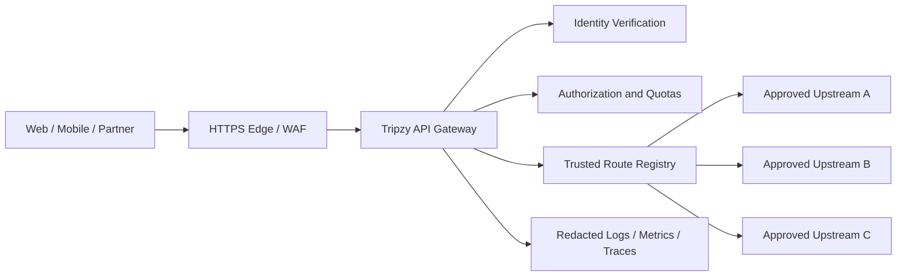
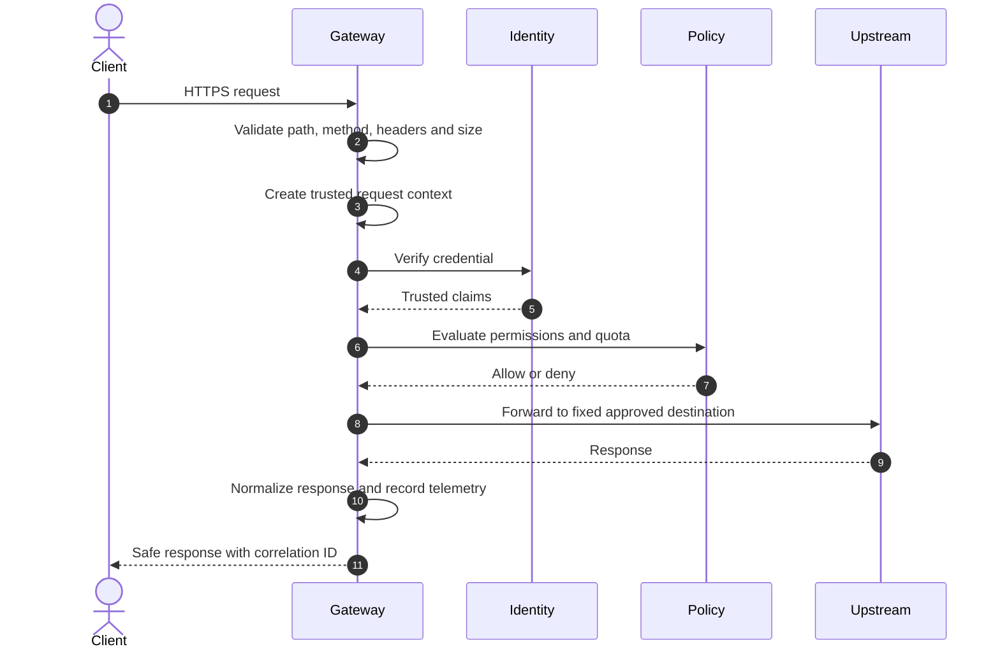

# 🚦 API Gateway Tripzy

<div align="center">

**A Node.js API gateway foundation for the Tripzy microservices ecosystem**

[](https://nodejs.org/)
[](./LICENSE)
[](https://github.com/Brajesh31/API-Gateway-Tripzy/actions/workflows/ci.yml)

</div>

> **Current status: architecture and documentation foundation.** The repository has a Node.js package manifest and detailed gateway design. A deployable gateway server, verified Tripzy upstream services, authentication integration, and production route contracts still need implementation. No service names or destinations are invented here.

## 🧭 Contents

- [Purpose](#-purpose)
- [Current implementation status](#-current-implementation-status)
- [Gateway responsibilities](#-gateway-responsibilities)
- [Proposed architecture](#-proposed-architecture)
- [Request lifecycle](#-request-lifecycle)
- [Repository structure](#-repository-structure)
- [Getting started](#-getting-started)
- [Configuration](#-configuration)
- [API contract status](#-api-contract-status)
- [Security baseline](#-security-baseline)
- [Testing and quality](#-testing-and-quality)
- [Observability](#-observability)
- [Deployment readiness](#-deployment-readiness)
- [Documentation](#-documentation)

## 🎯 Purpose

A gateway can provide a controlled client-facing boundary for Tripzy services. It can centralise routing, identity verification, authorization, request limits, quotas, timeouts, error mapping, and telemetry while leaving business rules and data ownership with the services.

A gateway is not merely a URL rewrite. Its behavior affects the security, reliability, performance, and compatibility of every client integration.

## 📌 Current implementation status

| Capability | Status | Notes |
|---|---|---|
| Node package metadata | Present | `package.json` |
| Environment example | Present | Proposed names only |
| Server process | Not implemented | No runtime server source |
| HTTP framework | Not selected | No framework dependency |
| Proxy/router | Not implemented | No routes or upstream registry |
| Authentication | Not implemented | Identity contract not confirmed |
| Authorization | Not implemented | Permission model not defined |
| Rate limiting | Not implemented | No quota middleware/store |
| Request correlation | Not implemented | No request middleware |
| Timeouts/retries | Not implemented | No outbound client |
| Health/readiness | Not implemented | No health endpoints |
| Automated tests | Not implemented | Test command remains a placeholder until a suite is added |
| Deployment | Not supported | No runtime or infrastructure config |

Do not call this repository a functioning gateway until a server, route policy, security middleware, and tests exist.

## 🧱 Gateway responsibilities

| Responsibility | Gateway role | Service owner role |
|---|---|---|
| Routing | Match approved public paths and methods | Own domain operation |
| Authentication | Verify trusted identity | Operate identity provider |
| Authorization | Enforce explicit route policy | Enforce resource-level rules |
| Validation | Apply public input constraints | Validate domain rules |
| Rate limiting | Apply client/user quotas | Define service capacity |
| Resilience | Timeouts and safe bounded retries | Define idempotency |
| Correlation | Propagate validated request ID | Continue trace across service |
| Error mapping | Return stable, safe errors | Document service errors |
| Persistence | Prefer stateless operation | Own domain data and database |

## 🏗️ Proposed architecture

The topology is a design target, not implemented infrastructure. The upstream labels are generic placeholders, not confirmed Tripzy services.



### Architectural rules

1. The gateway must not connect directly to every service database.
2. Upstream destinations must come from trusted configuration, never client input.
3. Authorization must happen before forwarding.
4. Forward only approved headers. Remove hop-by-hop and untrusted identity headers.
5. Apply request, response, concurrency and time limits.
6. Retry only operations with explicit idempotency guarantees.
7. Separate process liveness from upstream dependency health.
8. Never expose internal hosts, stack traces, tokens or raw upstream errors.

## 🔁 Proposed request lifecycle



## 🗂️ Repository structure

```text
API-Gateway-Tripzy/
├── .github/
│   ├── ISSUE_TEMPLATE/
│   ├── workflows/
│   └── PULL_REQUEST_TEMPLATE.md
├── docs/
│   ├── diagrams/
│   ├── api.md
│   ├── architecture.md
│   ├── configuration.md
│   ├── development.md
│   ├── deployment.md
│   ├── operations.md
│   ├── security.md
│   ├── service-contracts.md
│   ├── testing.md
│   └── threat-model.md
├── src/                    # runtime implementation to be added
├── tests/                  # actual suite to be added
├── .env.example
├── package.json
├── README.md
└── SECURITY.md
```

See [Project structure](./docs/project-structure.md).

## 🚀 Getting started

### Prerequisites

- Git.
- Node.js 20 or later.
- npm.
- Verified Tripzy service contracts before defining any upstream.

### Clone and install

```bash
git clone https://github.com/Brajesh31/API-Gateway-Tripzy.git
cd API-Gateway-Tripzy
npm install
```

The current repository has no runnable server implementation. The `start` and `dev` script declarations are intended for the future server entry point and must not be treated as a functioning deployment until that source exists. The test script remains a placeholder until tests are added.

## ⚙️ Configuration

The checked-in `.env.example` contains proposed settings. Environment loading and validation are not implemented.

| Variable | Intended purpose | Status |
|---|---|---|
| `PORT` | Gateway listener port | Example only |
| `LOG_LEVEL` | Log verbosity | Example only |
| `UPSTREAM_*_URL` | Approved service destination | Not configured |
| `JWT_ISSUER` | Expected token issuer | Not configured |
| `JWT_AUDIENCE` | Expected token audience | Not configured |
| `RATE_LIMIT_*` | Quota policy | Not configured |
| `*_TIMEOUT_MS` | Service deadline | Not configured |

Use a secret manager for credentials. Never commit production secrets or copy them into public variables.

## 🔌 API contract status

No route is implemented. Each future route must document method, path/version, authentication, permission, request/response schema, status mapping, timeout, retry/idempotency policy, rate-limit group, and service owner.

See [API conventions](./docs/api.md) and [service contract register](./docs/service-contracts.md).

## 🛡️ Security baseline

Before public traffic:
- Cryptographic token verification with explicit issuer, audience, expiry, and algorithm policy.
- Deny-by-default route authorization.
- Fixed upstream allowlists and SSRF protections.
- Request/header/response size and duration limits.
- Rate limiting and concurrency controls.
- Header allowlisting and hop-by-hop removal.
- Bounded timeouts and safe retry policy.
- TLS and trusted proxy configuration.
- Redacted structured logs.
- Dependency and secret scanning.
- Security regression tests.

See [SECURITY.md](./SECURITY.md), [Security guide](./docs/security.md), and [Threat model](./docs/threat-model.md).

## 🧪 Testing and quality

The target suite includes unit tests, contract tests for each registered service, mock-upstream integration tests, authorization and SSRF regression tests, fault injection, and controlled load tests.

No actual gateway test suite is committed yet. See [Testing](./docs/testing.md).

## 📈 Observability

The target baseline includes request count, latency percentiles, upstream timing, timeouts, retries, quota denials, authentication failures, and dependency health. Do not log access tokens, cookies, passwords, authorization headers, or full private payloads.

See [Operations](./docs/operations.md).

## 🚢 Deployment readiness

<badge color="warning">Not deployable</badge>

There is no runtime server, health endpoint, container definition, verified upstream configuration, or tested rollback. Production requires these components plus security controls, monitoring, capacity limits, and contract/integration tests.

See [Deployment](./docs/deployment.md).

## 📚 Documentation

| Guide | Coverage |
|---|---|
| [Documentation home](./docs/README.md) | Guide index and maintenance rules |
| [Project overview](./docs/project-overview.md) | Scope, goals and non-goals |
| [Architecture](./docs/architecture.md) | Components, trust boundaries and request flow |
| [Project structure](./docs/project-structure.md) | Proposed source responsibilities |
| [API](./docs/api.md) | Route contracts and errors |
| [Service contracts](./docs/service-contracts.md) | Upstream ownership and route register |
| [Configuration](./docs/configuration.md) | Environment and secrets |
| [Installation](./docs/installation.md) | Scaffold setup |
| [Development](./docs/development.md) | Implementation workflow |
| [Testing](./docs/testing.md) | Test layers and release gates |
| [Security](./docs/security.md) | Gateway defensive controls |
| [Threat model](./docs/threat-model.md) | Risks and mitigations |
| [Database](./docs/database.md) | Stateless design and persistence exceptions |
| [Deployment](./docs/deployment.md) | Readiness and rollback |
| [Operations](./docs/operations.md) | Telemetry and incident response |
| [Troubleshooting](./docs/troubleshooting.md) | Safe diagnostics |
| [FAQ](./docs/faq.md) | Project status and common questions |

## 🤝 Contributing

Read [CONTRIBUTING.md](./CONTRIBUTING.md). Route changes require a verified service contract, tests, security review, and documentation updates.

## 📄 License

MIT. See [LICENSE](./LICENSE).

Maintained by **Brajesh Kumar**: [@Brajesh31](https://github.com/Brajesh31).

Last updated: 2026-11-16 07:19 UTC
