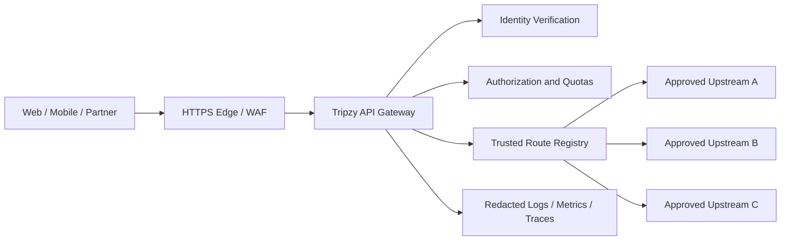

# 🚦 API Gateway Tripzy

<div align="center">

**A Node.js API gateway foundation for the Tripzy microservices ecosystem**

[](https://nodejs.org/)
[](https://developer.mozilla.org/en-US/docs/Web/JavaScript)
[](./LICENSE)
[](https://github.com/Brajesh31/API-Gateway-Tripzy/actions/workflows/ci.yml)

</div>

> **Current status: scaffold only, not deployable.** This repository has package metadata and documentation, but no gateway server, proxy routes, authentication middleware, upstream service registry, or test suite. The documentation distinguishes future design from shipped functionality.

## 🧭 Contents

- [Purpose](#-purpose)
- [Implementation status](#-implementation-status)
- [Gateway responsibilities](#-gateway-responsibilities)
- [Proposed architecture](#-proposed-architecture)
- [Request lifecycle](#-request-lifecycle)
- [Repository layout](#-repository-layout)
- [Getting started](#-getting-started)
- [Configuration](#-configuration)
- [API contract status](#-api-contract-status)
- [Security baseline](#-security-baseline)
- [Testing strategy](#-testing-strategy)
- [Observability](#-observability)
- [Deployment readiness](#-deployment-readiness)
- [Documentation](#-documentation)
- [Contributing](#-contributing)

## 🎯 Purpose

A gateway can provide one controlled client-facing boundary for Tripzy services. It can centralise routing, identity verification, authorization, request constraints, rate limiting, timeouts, error mapping, and telemetry while leaving business logic and data ownership in the microservices.

A gateway is not merely a URL rewrite. Its behavior affects security, reliability, performance, and the compatibility of every client integration.

## 📌 Implementation status

| Capability | Status | Notes |
|---|---|---|
| Node package metadata | Present | `package.json` |
| Environment example | Present | Proposed variable names only |
| Gateway server | Not implemented | No `index.js` or `src/server.js` |
| HTTP framework | Not selected | No framework dependency installed |
| Proxy/router | Not implemented | No routes or upstream registry |
| Authentication | Not implemented | Identity contract not confirmed |
| Authorization | Not implemented | Permission model not defined |
| Rate limiting | Not implemented | No quota store or middleware |
| Correlation IDs | Not implemented | No request middleware |
| Timeouts/retries | Not implemented | No outbound client |
| Health/readiness | Not implemented | No health endpoints |
| Automated tests | Not implemented | Existing test script is a failing placeholder |
| Deployment | Not supported | No runtime or deployment configuration |

Do not advertise this repository as a working gateway until the server, routing policy, security middleware, and tests are implemented.

## 🧱 Gateway responsibilities

| Responsibility | Gateway role | Service owner role |
|---|---|---|
| Routing | Match approved public paths and methods | Own domain operation |
| Authentication | Verify trusted identity | Operate identity provider |
| Authorization | Enforce explicit route policy | Enforce resource-level rules |
| Validation | Apply public input limits and schema rules | Validate domain constraints |
| Rate limiting | Apply client/user quotas | Define service capacity |
| Resilience | Timeouts and safe bounded retries | Define operation idempotency |
| Correlation | Propagate validated request ID | Continue trace across service |
| Error mapping | Return stable, safe errors | Return documented service errors |
| Persistence | Prefer stateless operation | Own domain data and database |

## 🏗️ Proposed architecture

This is a target design, not an implemented topology. Service names below are generic placeholders. No Tripzy upstreams are currently registered or configured.



### Architectural rules

1. The gateway must not connect directly to every service database.
2. Upstream destinations must come from trusted configuration, never client input.
3. Authorization must occur before forwarding.
4. Forward only approved headers. Remove hop-by-hop and untrusted identity headers.
5. Apply request, response, and time limits.
6. Retry only operations with explicit idempotency guarantees.
7. Separate process liveness from upstream dependency health.
8. Never expose internal hosts, stack traces, tokens, or raw upstream error payloads.

## 🔁 Request lifecycle


## 🗂️ Repository layout

The existing repository currently contains package metadata and docs. This is the proposed implementation layout:

```text
API-Gateway-Tripzy/
├── .github/
│   ├── ISSUE_TEMPLATE/
│   ├── workflows/
│   └── PULL_REQUEST_TEMPLATE.md
├── docs/
│   ├── diagrams/
│   ├── api.md
│   ├── architecture.md
│   ├── configuration.md
│   ├── development.md
│   ├── deployment.md
│   ├── operations.md
│   ├── security.md
│   ├── service-contracts.md
│   ├── testing.md
│   └── threat-model.md
├── src/                  # proposed, not yet implemented
│   ├── app.js
│   ├── server.js
│   ├── config/
│   ├── middleware/
│   ├── routes/
│   ├── clients/
│   ├── policies/
│   └── observability/
├── tests/                # proposed
│   ├── unit/
│   ├── contract/
│   ├── integration/
│   └── security/
├── .env.example
├── package.json
├── README.md
└── SECURITY.md
```

See [Project structure](./docs/project-structure.md) for responsibilities and proposed module boundaries.

## 🚀 Getting started

### Prerequisites

- Git.
- Node.js LTS supported by your deployment environment.
- npm.
- Confirmed Tripzy service contracts before defining any upstream.

### Clone and inspect

```bash
git clone https://github.com/Brajesh31/API-Gateway-Tripzy.git
cd API-Gateway-Tripzy
npm install
```

There is currently no `npm start` or `npm run dev` command. The existing `npm test` is a placeholder that exits with an error. No server is started by installing the package.

Read [Installation](./docs/installation.md) and [Development](./docs/development.md).

## ⚙️ Configuration

The checked-in `.env.example` describes potential settings only. Environment loading and validation are not implemented yet.

| Variable | Intended purpose | Current status |
|---|---|---|
| `PORT` | Listener port | Example only |
| `LOG_LEVEL` | Log verbosity | Example only |
| `UPSTREAM_*_URL` | Approved service destination | Not configured |
| `JWT_ISSUER` | Expected token issuer | Not configured |
| `JWT_AUDIENCE` | Expected token audience | Not configured |
| `RATE_LIMIT_*` | Quota policy | Not configured |
| `*_TIMEOUT_MS` | Service deadline | Not configured |

Never commit production secrets. Use a deployment secret manager and keep real configuration outside version control.

## 🔌 API contract status

No routes are currently implemented. Each future route must document method, public path/version, auth requirement, permission, request/response schema, status mapping, timeout, retry/idempotency behavior, rate-limit policy, and owning service.

See [API conventions](./docs/api.md) and the [service contract register](./docs/service-contracts.md).

## 🛡️ Security baseline

Before public traffic is enabled, the gateway requires:

- Cryptographic token verification with issuer, audience, expiry, and algorithm policy.
- Deny-by-default route authorization.
- Fixed upstream allowlists and SSRF protections.
- Request/header/response size and duration limits.
- Rate limiting and concurrency controls.
- Header allowlisting and hop-by-hop header removal.
- Bounded timeouts and safe retry policy.
- TLS and trusted proxy configuration.
- Redacted structured logs.
- Dependency and secret scanning.
- Security regression tests.

Read [SECURITY.md](./SECURITY.md), [Security guide](./docs/security.md), and [Threat model](./docs/threat-model.md).

## 🧪 Testing strategy

The intended suite includes unit tests, contract tests for every registered service, mock-upstream integration tests, authorization and SSRF regression tests, timeout/failure injection, and controlled load tests.

No such suite is currently committed. See [Testing](./docs/testing.md).

## 📈 Observability

The target baseline includes request count, latency percentiles, upstream timing, timeouts, retries, rate-limit rejections, auth failures, and dependency health. Never record access tokens, cookies, passwords, authorization headers, or full private payloads.

See [Operations](./docs/operations.md).

## 🚢 Deployment readiness

<badge color="warning">Not deployable</badge>

There is no runtime server, health endpoint, container definition, process manager, or verified upstream configuration. Production deployment requires those components plus security controls, monitoring, capacity limits, rollback, and contract/integration tests.

See [Deployment](./docs/deployment.md).

## 📚 Documentation

| Guide | Coverage |
|---|---|
| [Documentation home](./docs/README.md) | Guide index and maintenance rules |
| [Project overview](./docs/project-overview.md) | Goals, scope, non-goals and actors |
| [Architecture](./docs/architecture.md) | Trust boundaries and request lifecycle |
| [Project structure](./docs/project-structure.md) | Proposed file responsibilities |
| [API](./docs/api.md) | Route contracts and errors |
| [Service contracts](./docs/service-contracts.md) | Upstream owner and route registry |
| [Configuration](./docs/configuration.md) | Environment and secrets |
| [Installation](./docs/installation.md) | Current scaffold setup |
| [Development](./docs/development.md) | Implementation workflow |
| [Testing](./docs/testing.md) | Unit, contract, integration, security and load tests |
| [Security](./docs/security.md) | Gateway security controls |
| [Threat model](./docs/threat-model.md) | Assets, threats and mitigations |
| [Database](./docs/database.md) | Stateless design and state ownership |
| [Deployment](./docs/deployment.md) | Release readiness and rollback |
| [Operations](./docs/operations.md) | Telemetry and incident runbooks |
| [Troubleshooting](./docs/troubleshooting.md) | Safe diagnostics |
| [FAQ](./docs/faq.md) | Current status and design questions |

## 🤝 Contributing

Read [CONTRIBUTING.md](./CONTRIBUTING.md). Route changes require a verified service contract, tests, threat-model review, and documentation updates.

## 📄 License

MIT. See [LICENSE](./LICENSE).

Maintained by **Brajesh Kumar**: [@Brajesh31](https://github.com/Brajesh31).

Last updated: 2026-11-16 07:18 UTC
