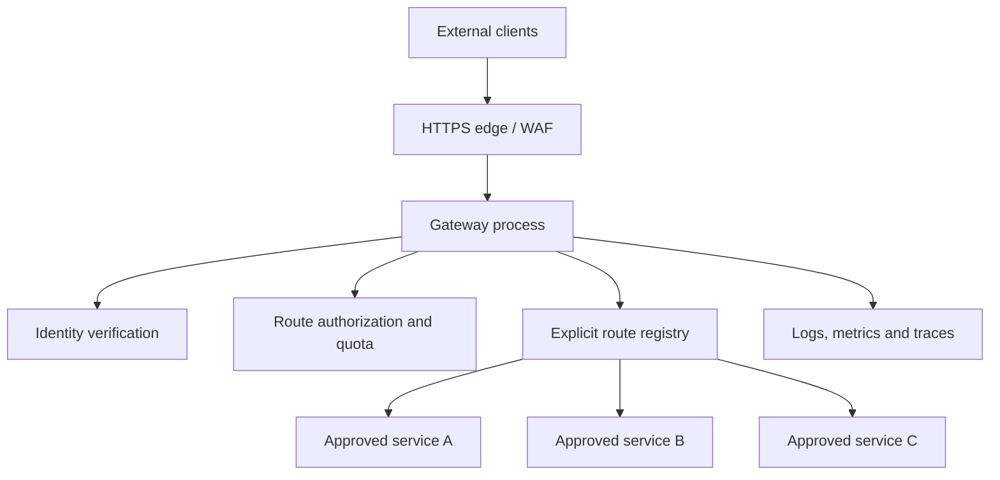

# 🏗️ Architecture and design

## Status

The target architecture is proposed only. No gateway process, route registry, authentication middleware, or upstream client is implemented yet.

## Logical topology

Service labels are placeholders. Replace them with verified Tripzy service ownership and contracts before implementation.

## Component responsibilities

| Component | Responsibility | Design constraint |
|---|---|---|
| Edge proxy | TLS and connection controls | Explicit trusted proxy hops |
| Gateway listener | Accept HTTP requests | Request and connection limits |
| Request context | Correlation and timing | Never trust arbitrary identity claims |
| Authentication | Verify tokens | Fail closed |
| Authorization | Apply route permissions | Default deny |
| Rate limiter | Enforce client/user quotas | Define distributed state and outage behavior |
| Route registry | Resolve fixed upstreams | No host from client input |
| Upstream client | Forward approved request data | Timeout, header and response limits |
| Error mapper | Stable public errors | No internal details |
| Telemetry | Operational events | Redact secrets and private data |

## Request processing

1. Edge accepts HTTPS and applies connection policy.
2. Gateway validates method, path, content type, and request size.
3. Request ID is generated or validated.
4. Authentication verifies the credential.
5. Authorization evaluates route permission.
6. Explicit registry resolves the fixed upstream.
7. Headers are filtered and hop-by-hop values removed.
8. Upstream call uses a service-specific deadline.
9. Retry is considered only when operation safety and retry budget permit.
10. Response/error is normalized and safe telemetry emitted.

## Failure mapping

| Failure | Candidate public status |
|---|---:|
| Unknown route | 404 |
| Invalid/missing token | 401 |
| Insufficient permission | 403 |
| Malformed request | 400 |
| Payload too large | 413 |
| Quota exceeded | 429 |
| Upstream unavailable or invalid response | 502/503 |
| Upstream deadline exceeded | 504 |
| Internal gateway fault | 500 |

Exact mappings must be approved in the API contract before release.

## Resilience

Set an overall request deadline and per-upstream budgets. Do not retry non-idempotent operations without a defined idempotency mechanism. Bound attempts and total retry time. Circuit breakers require clear half-open behavior and telemetry. Avoid coupling the health of all services to one dependency.

## Deployment topology

Multiple stateless gateway replicas behind a managed edge are a likely target. Shared quotas or idempotency state must be externalised or consistently shared. No deployment topology is currently configured in this repository.
