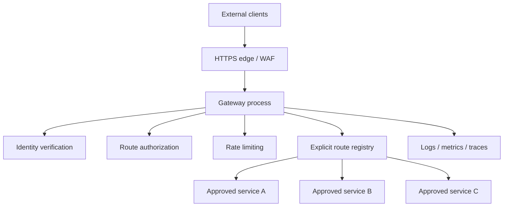

# 🏗️ Architecture and design

## Status

The architecture below is a proposed target design. No gateway process, route registry, token verification middleware, or upstream client is committed yet.

## Logical topology

The service labels are placeholders. Do not configure them until service owners provide real contracts.

## Component responsibilities

| Component | Responsibility | Design constraint |
|---|---|---|
| Edge proxy | TLS, connection protection, optional WAF | Configure trusted proxy hops explicitly |
| Gateway listener | Accept HTTP requests | Set size/time limits |
| Request context | Request ID, timing, safe metadata | Do not trust arbitrary identity headers |
| Authentication | Verify credentials/tokens | Fail closed on unverifiable identity |
| Authorization | Evaluate route permissions | Deny by default |
| Rate limiter | Enforce client/user/service quotas | Distributed state may be required |
| Route registry | Map path/method to fixed upstream | Never derive upstream host from request parameters |
| Upstream client | Forward allowed request data | Timeouts and header allowlist |
| Error mapper | Produce stable public errors | Never expose stack traces or internal addresses |
| Telemetry | Record safe operational events | Redact tokens and personal data |

## Request lifecycle

1. Edge accepts HTTPS traffic and applies connection controls.
2. Gateway validates method, path, content type, and request size.
3. A correlation ID is generated or validated using a strict policy.
4. Authentication verifies the presented identity.
5. Route-level authorization evaluates claims and resource policy.
6. The explicit route registry resolves a fixed upstream destination.
7. Request headers are filtered and hop-by-hop headers are removed.
8. The gateway forwards the request using a service-specific timeout.
9. Retry is considered only when the operation is safe and the retry budget permits it.
10. The public response is normalised and internal details are removed.
11. Telemetry records status and duration without sensitive values.

## Upstream registry model

A route registration should eventually include:
- Stable route identifier.
- Public path and allowed methods.
- API version.
- Destination identifier referencing trusted configuration.
- Authentication mode.
- Required permissions.
- Request/response validation strategy.
- Timeout budget.
- Retry policy and idempotency requirements.
- Rate limit group.
- Owning service/team.
- Contract test location.

Avoid scattering destination URLs through handlers.

## Failure model

| Failure | Public behavior | Internal behavior |
|---|---|---|
| Unknown route | 404 | Safe route-not-found event |
| Invalid/missing token | 401 | Authentication rejection metric |
| Insufficient permission | 403 | Authorization rejection metric |
| Invalid payload | 400 or 422 | Field-level safe diagnostics |
| Rate limit exceeded | 429 and retry guidance | Quota metric |
| Upstream timeout | 504 | Timeout metric with service ID |
| Upstream unavailable | 502 or 503 per contract | Circuit/dependency telemetry |
| Gateway internal fault | 500 with correlation ID | Redacted stack trace in restricted logs |

Choose the exact mapping consistently before implementation and document it in [API conventions](./api.md).

## Resilience decisions

- Set a deadline for the full inbound request.
- Reserve time for response serialization.
- Do not retry non-idempotent operations without an explicit idempotency mechanism.
- Bound retry count and total retry duration.
- Use circuit breaking only with clear half-open behavior and observability.
- Ensure one slow service cannot exhaust all gateway connections.
- Define whether partial aggregation is supported before implementing fan-out requests.

## Deployment topology

A typical target may contain multiple stateless gateway replicas behind a managed load balancer. Any distributed rate-limit/session state must be externalised or consistently shared. The current repository does not provide container or cloud deployment configuration.
