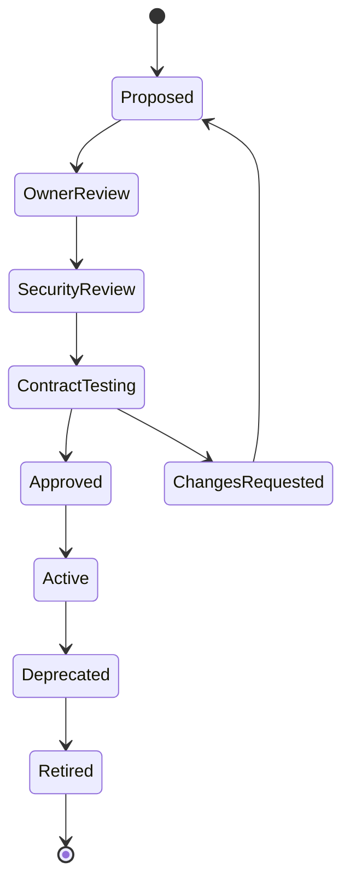

# 🧾 Upstream service contract register

## Current state

No upstream service names or URLs are confirmed or configured in this repository. Do not infer microservice boundaries from the Tripzy product name.

## Service register

| Service ID | Owner | Destination key | Public routes | Auth model | Timeout | Status |
|---|---|---|---|---|---|---|
| None registered | TBD | TBD | None | TBD | TBD | Not configured |

## Route registration template

```yaml
routeId: example-read
public:
  method: GET
  path: /api/v1/example
upstream:
  serviceId: example-service
  path: /internal/example
security:
  authentication: required
  permissions:
    - example:read
request:
  contentType: application/json
  maxBytes: 16384
resilience:
  timeoutMs: 2000
  retries: 0
  idempotencyRequired: false
rateLimit:
  policyId: authenticated-read
ownership:
  team: TBD
  contractDocument: TBD
```

This is a template, not active configuration.

## Required owner confirmation

1. Service ID and technical owner.
2. Internal base URL and network boundary.
3. Methods and paths permitted.
4. Token validation/service identity requirements.
5. Permission scopes and resource-level authorization.
6. Request and response schemas.
7. Payload size and upload behavior.
8. Latency and timeout budget.
9. Retryability and idempotency guarantees.
10. Rate and concurrency limits.
11. Error semantics and health behavior.
12. Contract test environment and escalation channel.

## Destination safety

- Destinations come from trusted deployment configuration.
- Never accept target URL/hostname from request path, query, body or headers.
- Prefer fixed service IDs over arbitrary destinations.
- Validate scheme, hostname, port and allowed address ranges at configuration time.
- Restrict redirects and protect against DNS rebinding.
- Block metadata endpoints and unapproved private networks.

## Contract lifecycle


