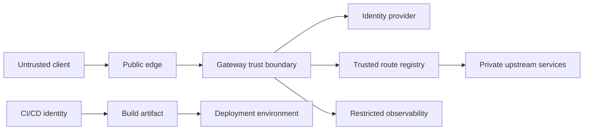

# 🧨 Threat model

## Scope and caveat

This threat model addresses the proposed Tripzy API gateway. It is not a penetration test. Since the gateway runtime is not implemented, listed controls are required future mitigations rather than verified defenses.

## Assets

- Client identity and authorization claims.
- Service-to-service credentials.
- Upstream destination configuration.
- Tripzy service availability and data integrity.
- Public API contracts.
- Logs, metrics, and traces.
- CI/CD credentials and release artifacts.

## Trust boundaries

## Threat register

| Threat | Attack scenario | Required mitigation |
|---|---|---|
| Broken authentication | Forged or expired token accepted | Strict signature, issuer, audience and expiry verification |
| Broken authorization | Caller reaches another user's resource | Route permissions and service-level object checks |
| SSRF | Caller controls upstream host | Fixed destination registry and outbound network policy |
| Open proxy | Arbitrary URL forwarding | No client-selected destinations |
| Header spoofing | Caller supplies trusted user/role header | Strip and recreate identity headers only from verified claims |
| Request smuggling ambiguity | Edge and gateway parse boundaries differently | Consistent HTTP parser/proxy configuration and regression tests |
| Denial of service | Large bodies or high concurrency exhaust resources | Body/header/time/concurrency limits and rate limiting |
| Retry storm | Outage triggers repeated retries | Small bounded retry budgets, idempotency checks and circuit controls |
| Sensitive data leak | Token or private upstream error returned/logged | Header/body redaction and normalized error mapping |
| Dependency compromise | Malicious or vulnerable package introduced | Lockfile, audit, review and pinned workflow actions |
| Misconfiguration | Production routes point to unintended hosts | Startup validation and environment-specific deployment review |
| Observability abuse | Logs become a secondary data leak | Access control, retention, redaction and audit |

## Abuse cases

- Missing/invalid token on every protected route.
- Valid token with wrong issuer, audience, algorithm, or scope.
- User A requests User B's resource.
- Spoofed identity headers combined with a valid low-privilege token.
- Request chooses arbitrary hostname, port, scheme, path, or redirect target.
- Compressed or chunked payload exceeds configured limits.
- Repeated slow upstream responses exhaust sockets.
- POST operation is retried after uncertain timeout.
- Upstream returns oversized headers or body.
- Unexpected upstream redirect points at an internal address.

## Risk priorities

**P0 before internet exposure:** authentication, authorization, SSRF protection, trusted upstream allowlist, rate/body/time limits, credential management.

**P1 before general availability:** contract tests, structured redacted logs, metrics, concurrency isolation, dependency scanning, incident runbooks.

**P2 maturity:** independent penetration test, chaos testing, routine access review, formal SLO and error-budget process.

## Residual risk

Even a secure gateway cannot replace authorization in a service that owns resource data. Internal services should still authenticate gateway/service identities and enforce domain-specific permissions. A compromised gateway is a high-impact event and requires restricted network access, minimal credentials, monitoring, and a tested response plan.
