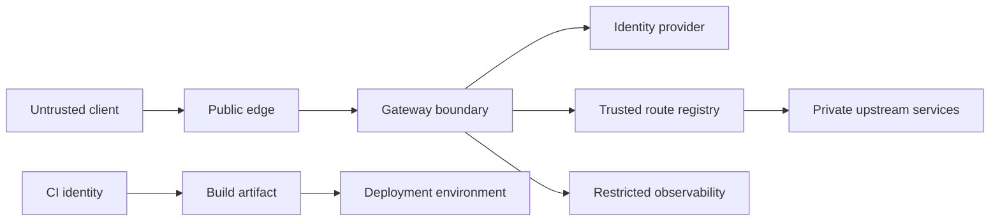

# 🧨 Threat model

## Scope

This model addresses the proposed API gateway. It is not a penetration test. Since runtime code is absent, mitigations are requirements, not verified defenses.

## Assets

- Client identity and permission claims.
- Service-to-service credentials.
- Trusted upstream destination registry.
- Upstream service availability and data integrity.
- Public API contracts.
- Logs, metrics and traces.
- CI/CD credentials and release artifacts.

## Trust boundaries

## Threat register

| Threat | Example | Required mitigation |
|---|---|---|
| Broken authentication | Forged/expired token accepted | Signature, issuer, audience, expiry verification |
| Broken authorization | Caller reads another user's record | Route permissions and service-level object checks |
| SSRF | Caller controls upstream host | Fixed registry and outbound network policy |
| Open proxy | Arbitrary URL forwarding | No client-selected destinations |
| Header spoofing | Fake role/user header | Strip and recreate only from verified claims |
| Request smuggling | Edge and gateway parse differently | Consistent proxy/parser config and regression tests |
| Denial of service | Large bodies/concurrency exhaust process | Body/header/time/concurrency limits and quotas |
| Retry storm | Outage creates repeated calls | Bounded budgets and idempotency checks |
| Information leakage | Raw token/upstream error is returned | Redaction and normalized error mapping |
| Dependency compromise | Vulnerable package is introduced | Lockfile, audit, review, pinned workflows |
| Misconfiguration | Route points to unintended service | Startup validation and deployment review |
| Telemetry leakage | Logs expose personal data | Redaction, access control and retention |

## Abuse cases to test

- Missing/invalid token on protected routes.
- Wrong issuer, audience, algorithm, signature or scope.
- Cross-user resource request.
- Spoofed identity header with low-privilege token.
- Arbitrary scheme, hostname, port or redirect.
- Compressed/chunked body over limit.
- Slow upstream consumes connection pool.
- Mutation is retried after uncertain outcome.
- Upstream returns oversized response.
- Redirect targets internal network.

## Priorities

**P0 before internet exposure:** authentication, authorization, trusted upstream allowlist, SSRF protections, rate/body/time limits, credential management.

**P1 before general availability:** contract tests, redacted telemetry, metrics, concurrency isolation, dependency scanning and incident runbooks.

**P2 maturity:** independent security assessment, chaos testing, routine access review and formal SLO/error-budget process.

A gateway cannot replace the domain service's own resource-level authorization. Internal services must authenticate the gateway identity and protect their data independently.
